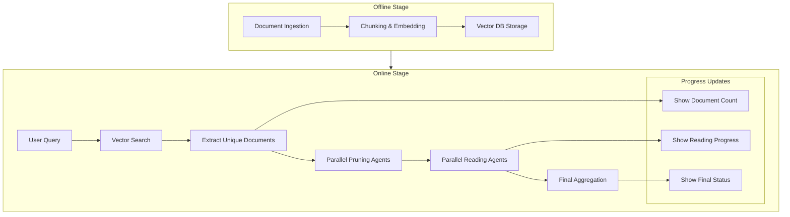

# Design Doc: Legal AI RAG System

> Please DON'T remove notes for AI

## Requirements

> Notes for AI: Keep it simple and clear.
> If the requirements are abstract, write concrete user stories

**Core Problem**: Build a legal case law retrieval system that prioritizes recall over precision to avoid missing critical legal precedents. Traditional keyword search and simple RAG can miss nuanced legal issues.

**User Stories**:
1. As a legal researcher, I want to query "criminal cases involving pedophiles" and get comprehensive results without missing any relevant precedents
2. As a legal professional, I need the system to ground all answers in actual case law to prevent hallucinations
3. As a user, I want real-time feedback showing the system's progress through document retrieval, pruning, and analysis
4. As a researcher, I need the system to handle complex legal queries involving nuanced reasoning, not just keyword matches

**Success Criteria**:
- High recall: Don't miss important legal precedents
- No hallucination: All answers grounded in retrieved case law  
- Real-time progress updates in UI
- Handle complex legal reasoning queries
- Efficient processing through parallel agents

## Flow Design

> Notes for AI:
> 1. Consider the design patterns of agent, map-reduce, rag, and workflow. Apply them if they fit.
> 2. Present a concise, high-level description of the workflow.

### Applicable Design Patterns:

1. **RAG Pattern**: Initial vector retrieval + context augmentation for final generation
2. **Agent Pattern**: Pruning agents and reading agents that make decisions based on context
3. **Workflow Pattern**: Multi-stage pipeline from ingestion to final response
4. **Parallel Processing**: Multiple pruning and reading agents running concurrently

### Flow High-level Design:

**Offline Stage (Document Ingestion)**:
1. **Document Ingestion**: Process legal case files with metadata binding
2. **Vector Database Creation**: Chunk documents and create embeddings
3. **Index Storage**: Store in optimal vector database

**Online Stage (Query Processing)**:
1. **Initial Retrieval**: Vector search to get high-recall chunks (>50% similarity)
2. **Document Extraction**: Extract unique document names from retrieved chunks
3. **Parallel Pruning**: Run pruning agents to filter relevant documents
4. **Parallel Reading**: Extract relevant information from filtered documents  
5. **Final Aggregation**: Combine all information into final response
6. **Progress Updates**: Real-time UI updates throughout the process



## Utility Functions

> Notes for AI:
> 1. Understand the utility function definition thoroughly by reviewing the doc.
> 2. Include only the necessary utility functions, based on nodes in the flow.

1. **LLM Wrapper** (`utils/call_llm.py`)
   - *Input*: prompt (str), optional system message
   - *Output*: response (str)
   - Used by all agent nodes for decision making and text processing

2. **Vector Database Interface** (`utils/vector_db.py`)
   - *Input*: embeddings, metadata, query vectors
   - *Output*: similarity search results with scores
   - Used for document storage and retrieval

3. **Embedding Service** (`utils/embedding.py`)
   - *Input*: text (str)
   - *Output*: vector embedding (list of floats)
   - Used for document indexing and query embedding

4. **File Processing** (`utils/file_processor.py`)
   - *Input*: file path
   - *Output*: text content with metadata
   - Used for document ingestion with metadata binding

5. **Text Chunking** (`utils/chunking.py`)
   - *Input*: text (str), chunk size, overlap
   - *Output*: list of text chunks with metadata
   - Used for preparing documents for vector storage

6. **Progress Tracker** (`utils/progress.py`)
   - *Input*: progress updates
   - *Output*: UI state updates
   - Used for real-time progress display

## Node Design

### Shared Store

> Notes for AI: Try to minimize data redundancy

The shared store structure is organized as follows:

```python
shared = {
    # User input
    "user_query": "string - original user query",
    
    # Retrieval results
    "retrieved_chunks": [{"text": "chunk", "metadata": {...}, "score": 0.8}],
    "unique_documents": ["doc1.txt", "doc2.txt", ...],
    
    # Pruning results
    "pruning_results": {"doc1.txt": True, "doc2.txt": False, ...},
    "relevant_documents": ["doc1.txt", "doc3.txt", ...],
    
    # Reading results
    "document_summaries": {"doc1.txt": "summary text", ...},
    
    # Final output
    "final_response": "aggregated response",
    
    # Progress tracking
    "progress": {
        "stage": "retrieval|pruning|reading|aggregation",
        "documents_found": 25,
        "documents_being_read": ["doc1.txt", "doc2.txt"],
        "completed_readings": 3,
        "total_readings": 5
    }
}
```

### Node Steps

> Notes for AI: Carefully decide whether to use Batch/Async Node/Flow.

**Offline Nodes**:

1. **Document Ingestion Node**
   - *Purpose*: Process legal case files and extract text with metadata
   - *Type*: BatchNode (processes multiple files)
   - *Steps*:
     - *prep*: Read list of file paths from shared store
     - *exec*: Extract text and metadata from each file
     - *post*: Store processed documents in shared store

2. **Vector Index Creation Node**
   - *Purpose*: Chunk documents, create embeddings, and store in vector DB
   - *Type*: BatchNode (processes multiple documents)
   - *Steps*:
     - *prep*: Read processed documents from shared store
     - *exec*: Chunk text, create embeddings, store in vector DB
     - *post*: Confirm indexing completion

**Online Nodes**:

3. **Initial Retrieval Node**
   - *Purpose*: Perform high-recall vector search for user query
   - *Type*: Regular Node
   - *Steps*:
     - *prep*: Read user query from shared store
     - *exec*: Embed query and search vector DB (>50% similarity)
     - *post*: Store retrieved chunks in shared store

4. **Document Extraction Node**
   - *Purpose*: Extract unique document names from retrieved chunks
   - *Type*: Regular Node
   - *Steps*:
     - *prep*: Read retrieved chunks from shared store
     - *exec*: Extract and deduplicate document names
     - *post*: Store unique documents list and update progress

5. **Pruning Agent Node**
   - *Purpose*: Determine if a document is relevant to the query
   - *Type*: AsyncParallelBatchNode (parallel processing of documents)
   - *Steps*:
     - *prep_async*: Read document list and user query
     - *exec_async*: Use LLM to determine document relevance
     - *post_async*: Store pruning results and update progress

6. **Reading Agent Node**
   - *Purpose*: Extract relevant information from filtered documents
   - *Type*: AsyncParallelBatchNode (parallel reading of documents)
   - *Steps*:
     - *prep_async*: Read relevant documents and user query
     - *exec_async*: Use LLM to extract/summarize relevant information
     - *post_async*: Store summaries and update reading progress

7. **Aggregation Agent Node**
   - *Purpose*: Combine all information into final response
   - *Type*: Regular Node
   - *Steps*:
     - *prep*: Read all document summaries and user query
     - *exec*: Use LLM to synthesize final comprehensive response
     - *post*: Store final response and mark completion

8. **Progress Update Node**
   - *Purpose*: Update UI with real-time progress information
   - *Type*: Regular Node (called after each major stage)
   - *Steps*:
     - *prep*: Read current progress state
     - *exec*: Format progress information for UI
     - *post*: Update progress in shared store and trigger UI refresh